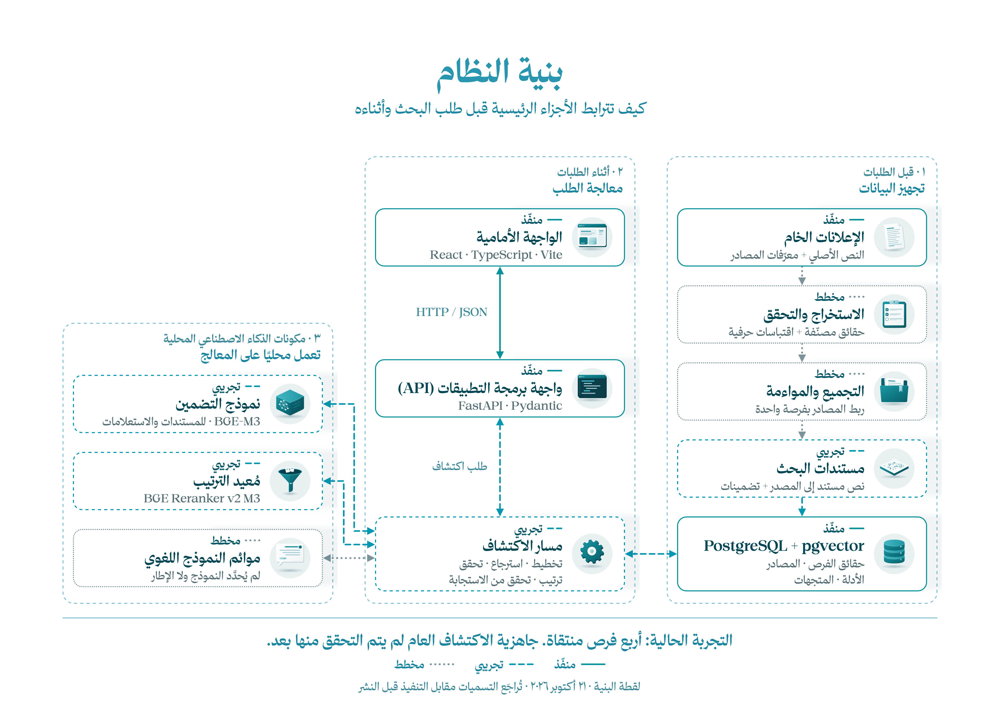

[English](README.md) | **العربية**

# فرصة — كيف نفّذنا المشروع

هذا تطبيقنا المبني على **fursah-starter**، نشاركه ليتتبّع المتدرب التصميم والكود والتقييم. هو طريقة تنفيذ واحدة، وليس بنية إلزامية أو حلًا جاهزًا للإنتاج.

احتفظنا بواجهة React وعقد API، وأضفنا تجهيز البيانات والتخزين وربط النماذج والاسترجاع وفحص الأدلة والتقييم.

## تصميم النظام

**المسار الحالي:** واجهة React ← تتواصل مع FastAPI، ثم يفهم Gemini الطلب، ويحوّله BGE-M3 إلى متجه، وتسترجع PostgreSQL/pgvector المرشحين، ويعيد BGE ترتيبهم، ثم يفحص الكود القيود والأهلية ويُرجع الاستجابة.

يحتوي الفهرس المحفوظ على **913 فرصة**: 900 فرصة جُمّعت من 1,000 إعلان، إضافة إلى 13 فرصة محفوظة. البحث يستخدم هذه البيانات ولا يتصفح مواقع خارجية.

> **التصميم الأولي، 21 أكتوبر 2026:** يعرض الرسم تجربة سابقة بأربع فرص؛ حالات التنفيذ المكتوبة فيه تاريخية. أصبح تجهيز البيانات وربط Gemini موجودين، ويبحث التطبيق في الفهرس الأكبر، لكن اعتماد الجودة ما زال معلقًا.



## الأدوات التي اخترناها

| الأداة | سبب استخدامها |
|---|---|
| React وTypeScript وVite | واجهة الملف الشخصي والبحث والأدلة |
| FastAPI وPydantic | نقاط API والتحقق من عقود الطلب والاستجابة |
| Gemini عبر OpenRouter باستخدام HTTPX | اقتراح خطة بحث يتحقق منها الكود |
| BGE-M3 وBGE reranker محليًا | الاسترجاع بالمعنى ثم مقارنة صلة المرشحين بالطلب |
| PostgreSQL وpgvector | تخزين الحقائق والمصادر والمتجهات |
| OpenTelemetry وPhoenix | مشاهدة مراحل الطلب وأزمنتها ودرجات التقييم |

هذا مسار RAG يديره كود Python، ولا يتطلب LangChain أو LangGraph أو PydanticAI. يقترح النموذج خطة، ويتحقق منها الكود ويطبّق قواعد العمل. وتستند أسباب التوصية إلى اقتباسات من المصادر.

## اقرأ التنفيذ بهذا الترتيب

1. [البيانات](data/README.ar.md): من الإعلانات إلى الفهرس المجهّز.
2. [الخلفية](backend/README.ar.md): من الطلب إلى الاستجابة.
3. [الواجهة](frontend/README.ar.md): الملف الشخصي والبحث والتفاصيل.
4. [التقييم](evals/README.ar.md): تشغيل الحالات وفهم النتائج والإخفاقات.

## التشغيل

سكربتات الإعداد مخصصة لـ **Windows PowerShell** مع Python 3.11 وNode.js 22 وPostgreSQL 18. يحتاج إعداد pgvector أيضًا إلى أدوات Visual Studio C++. اتبع [إعداد الخلفية](backend/README.ar.md#setup) أولًا لتجهيز الاعتماديات والقاعدة والنماذج والإعدادات.

من جذر المستودع، شغّل كل أمر في طرفية منفصلة:

```powershell
.\backend\run.ps1 -Port 8019
npm --prefix frontend run dev
```

ضع `FURSAH_DEV_API_TARGET=http://127.0.0.1:8019` في `frontend/.env`. افتح [الواجهة](http://127.0.0.1:5173) و[توثيق API](http://127.0.0.1:8019/docs). لم نتحقق من تشغيل سكربتات Windows على macOS أو Linux ضمن تحديث التوثيق هذا.

## ماذا تعلمنا من التقييم؟

نجحت **7 من 12 حالة تطوير** في [خط الأساس المسجل بتاريخ 22 أكتوبر](evals/archive/reports/catalog-eval-baseline-v1-review.md)، بعد تدقيق مستقل لنصوص المصادر. ظهرت فرص مغلقة وتوصيات غير مرتبطة في الحالات الفاشلة. بلغ متوسط زمن الطلب **30.1 ثانية** في ذلك التشغيل المحلي، واستغرق استدلال النماذج معظم الوقت.

هذه قياسات محفوظة وليست نتائج تشغيل جديد أو نسبة نجاح عامة. يحتفظ `/ready` ببوابة اعتماد الجودة والنشر، وحالته الموثقة 503 حتى الاعتماد. اقرأ دليل التقييم قبل الاعتماد على جودة التطبيق.
