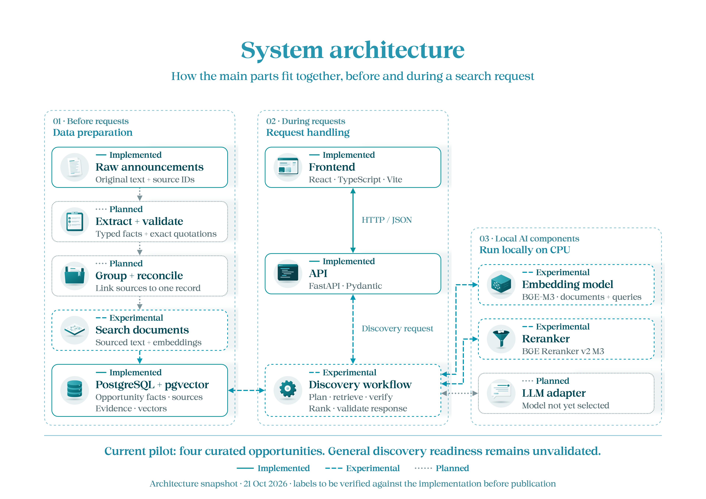

**English** | [العربية](README.ar.md)

# FURSAH — How we built it

This is our implementation of **fursah-starter**, shared so trainees can follow our design, code and evaluation. It is one approach, not a required architecture or a production-ready reference answer.

We kept the React interface and public API contract, then added data preparation, PostgreSQL storage, model integration, retrieval, evidence checks and evaluation.

## System design

**Current flow:** React → FastAPI → Gemini request understanding → BGE-M3 query embedding → PostgreSQL/pgvector retrieval → BGE reranking → constraint and eligibility checks → response.

The saved catalog contains **913 opportunities**: 900 grouped from 1,000 supplied announcements, plus 13 saved additions. Searches use this catalog; they do not browse external websites.

> **Initial design, 21 October 2026:** the diagram below describes the earlier four-opportunity pilot. Its status labels are historical. Preparation and Gemini integration now exist, and retrieval searches the larger catalog; quality approval is still pending.



## Our tools and choices

| Tool | Why we use it |
|---|---|
| React, TypeScript, Vite | Profile, search and evidence interface |
| FastAPI, Pydantic | HTTP endpoints and validated contracts |
| Gemini through OpenRouter, using HTTPX | Turn the request into a checked search plan |
| BGE-M3 and BGE reranker, running locally | Retrieve by meaning, then compare query–candidate relevance |
| PostgreSQL + pgvector | Store facts, sources and searchable vectors |
| OpenTelemetry + Phoenix | Inspect request stages, timing and evaluation scores |

This is a Python-controlled RAG workflow. It does not require LangChain, LangGraph or PydanticAI. The model proposes a plan; code checks it and applies the business rules. Recommendation explanations quote source evidence.

## Read the implementation

1. [Data](data/README.md): announcements → prepared catalog.
2. [Backend](backend/README.md): request → supported response.
3. [Frontend](frontend/README.md): profile → search → details.
4. [Evaluation](evals/README.md): run cases → inspect traces → identify failures.

## Run it

The supplied setup scripts target **Windows PowerShell**, Python 3.11, Node.js 22 and PostgreSQL 18. The pgvector setup also requires Visual Studio C++ build tools. See the [backend setup](backend/README.md#setup) first; these commands assume its dependencies, database, models and settings are ready.

From the repository root, use separate terminals:

```powershell
.\backend\run.ps1 -Port 8019
npm --prefix frontend run dev
```

In `frontend/.env`, set `FURSAH_DEV_API_TARGET=http://127.0.0.1:8019`. Open [the interface](http://127.0.0.1:5173) and [API documentation](http://127.0.0.1:8019/docs). The supplied Windows scripts have not been validated on macOS/Linux in this documentation update.

## What evaluation taught us

The [recorded 22 October baseline](evals/archive/reports/catalog-eval-baseline-v1-review.md) passed **7 of 12 development cases** after an independent source audit. Failures included closed opportunities and unrelated recommendations. Average request time was **30.1 seconds** in that local run, largely spent on model inference.

These are recorded measurements, not new test results or a general success rate. `/ready` retains the quality/deployment gate and is documented as returning 503 until approval. Read the evaluation guide before treating this implementation as reliable.
