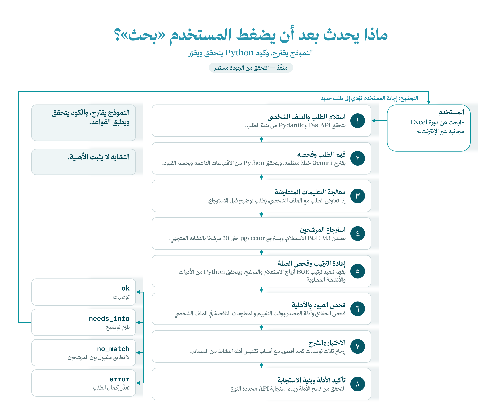

[English](README.md) | **العربية**

# الخلفية — من الطلب إلى التوصية

[الرئيسية](../README.ar.md) · [السابق: البيانات](../data/README.ar.md) · [التالي: الواجهة](../frontend/README.ar.md)

تستقبل FastAPI الطلب، ويتحقق Pydantic من بنيته. يجمع مسار Python بين خطة يقترحها النموذج والاسترجاع وقواعد صريحة تستند إلى المصادر.

## تتبّع طلبًا واحدًا

مثال: **«دورة Excel مجانية عن بُعد»**.

1. يقترح Gemini الموضوع والقيود. يتحقق الكود من اقتباساته داخل الطلب ويعالج التعارض مع الملف الشخصي.
2. يحوّل BGE-M3 نص البحث إلى متجه، وتسترجع pgvector المرشحين؛ العدد الافتراضي 20.
3. يقيّم BGE reranker الصلة، ويفحص الكود الأدوات والأنشطة المطلوبة.
4. تفحص قواعد القيود والأهلية الحقائق وأدلة المصادر ومعلومات المستخدم الناقصة.
5. يطلب المسار توضيحًا مؤثرًا، أو يعرض حتى ثلاث توصيات، أو يعيد عدم تطابق/خطأ. ويتحقق من نسخ الأدلة قبل إرجاع التوصيات.

يقتبس سبب التوصية نشاطًا من المصدر؛ لا يكتبه استدعاء ثانٍ لنموذج لغوي. التشابه العالي لا يثبت الأهلية.

> يلخّص الرسم مسار الفهرس الكامل الحالي. قد يرجع مسار التوضيح قبل الاسترجاع؛ وجود الفحوص لا يضمن جودة التوصيات.



## أين تقرأ الكود؟

| الملف داخل `app/` | المسؤولية |
|---|---|
| [routes.py](app/routes.py) و[schemas.py](app/schemas.py) | نقاط HTTP والعقود العامة |
| [catalog_workflow.py](app/catalog_workflow.py) | مسار البحث الحالي كاملًا |
| [active_understanding.py](app/active_understanding.py) | استدعاء Gemini والتحقق من اقتراحه |
| [request_plan.py](app/request_plan.py) و[request_requirements.py](app/request_requirements.py) | تعارض القيود ومتطلبات الأدوات والأنشطة |
| [catalog_store.py](app/catalog_store.py) | الفهرس في PostgreSQL والاسترجاع بالمتجهات |
| [constraints.py](app/constraints.py) و[eligibility.py](app/eligibility.py) | القرارات المستندة إلى المصدر وأسئلة التوضيح |
| [infrastructure/models/](app/infrastructure/models/) | ربط النماذج المحلية |
| [instrumentation/](app/instrumentation/README.ar.md) | تتبّع مراحل الطلب |

النتائج هي `ok` و`needs_info` و`no_match` و`error`. طلب معلومات ناقصة نتيجة طبيعية وليس فشلًا في التثبيت.

<a id="setup"></a>
## الإعداد

نفّذ الأوامر في **Windows PowerShell من جذر المستودع** بعد تثبيت [المتطلبات](../README.ar.md):

```powershell
.\backend\setup.ps1 -Models -Evals -Frontend
.\backend\scripts\setup-postgres.ps1
.\.venv\Scripts\python.exe backend/scripts/download-model.py
.\.venv\Scripts\python.exe backend/scripts/download-reranker.py
```

أنشئ `backend/.env` من [.env.example](.env.example) إذا لم يكن موجودًا. ضع مفتاح OpenRouter في `FURSAH_MODEL_API_KEY`. احتفظ بإعدادات نموذج Gemini والمزوّد في المثال؛ يتحقق الربط الحالي منها. استخدم `FURSAH_CATALOG_MODE=prepared` و`FURSAH_UNDERSTANDING_MODE=active`، واترك التجربة القديمة معطلة. تبقى المفاتيح في الخلفية.

```powershell
.\.venv\Scripts\python.exe backend/scripts/prepare-catalog.py --publish
.\backend\run.ps1 -Port 8000
```

أمر `run.ps1` يختار Python الموجود في `.venv` تلقائيًا. للتشغيل المباشر من داخل مجلد `backend`، في CMD أو PowerShell:

```powershell
..\.venv\Scripts\python.exe -m uvicorn app.main:app --reload --port 8000
```

اختَر منفذًا يطابق إعداد الواجهة. أمر `uvicorn` العام يتبع بيئة Python الموجودة في PATH؛ استخدام Python المشروع صراحةً يحمّل اعتمادياته المثبتة.

يجهّز النشر الفهرس والمتجهات الناقصة ويحفظ إصدارًا في PostgreSQL. يشرح [دليل البيانات](../data/README.ar.md) إعادة استخدام الحزمة المحفوظة.

يستخدم `FURSAH_EVALUATION_TIME` وقت الطلب الفعلي افتراضيًا. للوقت المرجعي التدريبي استخدم `2026-10-18T12:00:00+03:00`، دون تغيير تواريخ المصادر. يفحص `/health` أن الخادم يعمل، بينما يتضمن `/ready` فحوص الجاهزية والاعتماد؛ لذلك قد يعيد 503 رغم عمل API. الإخفاقات موضحة في [دليل التقييم](../evals/README.ar.md).
