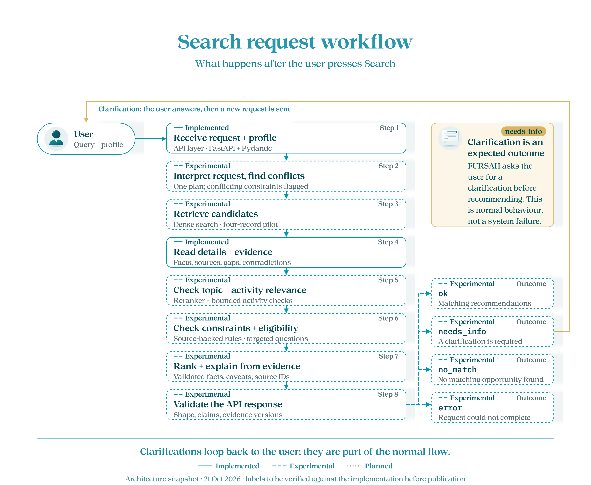

**English** | [العربية](README.ar.md)

# Backend — from request to recommendation

[Overview](../README.md) · [Previous: data](../data/README.md) · [Next: frontend](../frontend/README.md)

FastAPI receives the request; Pydantic checks its structure. Our Python workflow combines a model-generated plan with retrieval and explicit source-based rules.

## Follow one request

For **“a free online Excel course”**:

1. Gemini proposes the topic and constraints. Code checks its quotations against the request and resolves profile conflicts.
2. BGE-M3 embeds the search text; pgvector retrieves candidates (20 by default).
3. The BGE reranker scores relevance. Additional code checks the requested tools and activities.
4. Constraint and eligibility checks inspect facts, source evidence and missing user information.
5. The workflow asks a useful clarification, returns up to three recommendations, or reports no match/error. It confirms evidence versions before returning recommendations.

Reasons quote an activity from the source; a second LLM does not write the final explanation. High similarity alone is not proof of eligibility.

> **Historical diagram:** this shows the four-record pilot. The current code uses Gemini and the full prepared catalog. Stage labels below are not current readiness claims.



## Where to read the code

| File under `app/` | Responsibility |
|---|---|
| [routes.py](app/routes.py), [schemas.py](app/schemas.py) | HTTP entry points and public contracts |
| [catalog_workflow.py](app/catalog_workflow.py) | Current end-to-end discovery flow |
| [active_understanding.py](app/active_understanding.py) | Gemini call and checked request proposal |
| [request_plan.py](app/request_plan.py), [request_requirements.py](app/request_requirements.py) | Constraint conflicts and tool/activity requirements |
| [catalog_store.py](app/catalog_store.py) | PostgreSQL catalog and vector retrieval |
| [constraints.py](app/constraints.py), [eligibility.py](app/eligibility.py) | Source-based decisions and clarification questions |
| [infrastructure/models/](app/infrastructure/models/) | Local model adapters |
| [instrumentation/](app/instrumentation/README.md) | Request-stage traces |

Outcomes are `ok`, `needs_info`, `no_match` and `error`. Missing information is an expected outcome, not an installation failure.

<a id="setup"></a>
## Setup

Run these commands in **Windows PowerShell from the repository root**, with the [prerequisites](../README.md#run-it) installed:

```powershell
.\backend\setup.ps1 -Models -Evals -Frontend
.\backend\scripts\setup-postgres.ps1
.\.venv\Scripts\python.exe backend/scripts/download-model.py
.\.venv\Scripts\python.exe backend/scripts/download-reranker.py
```

Create `backend/.env` from [.env.example](.env.example) only if it is missing. Set `FURSAH_MODEL_API_KEY` to your OpenRouter key. Keep the example's Gemini model/provider settings: this adapter checks them. Use `FURSAH_CATALOG_MODE=prepared`, `FURSAH_UNDERSTANDING_MODE=active` and leave the historical pilot disabled. Keep credentials in the backend.

```powershell
.\.venv\Scripts\python.exe backend/scripts/prepare-catalog.py --publish
.\backend\run.ps1 -Port 8019
```

The `run.ps1` script selects the project's `.venv` Python automatically. To run directly from **inside `backend/`**, in CMD or PowerShell:

```powershell
..\.venv\Scripts\python.exe -m uvicorn app.main:app --reload --port 8000
```

Choose a port matching the frontend configuration. A bare `uvicorn` command uses the Python environment on PATH; explicitly invoking the project Python uses its installed dependencies.

Publishing prepares the catalog and missing embeddings, then stores a release in PostgreSQL. See [data](../data/README.md) for reusing the saved package.

`FURSAH_EVALUATION_TIME` defaults to actual request time. For the classroom reference use `2026-10-18T12:00:00+03:00`; source dates stay unchanged. `/health` checks liveness; `/ready` also checks readiness/approval, so a running API can still return 503 there. Evaluation failures are documented in the [evaluation guide](../evals/README.md).
