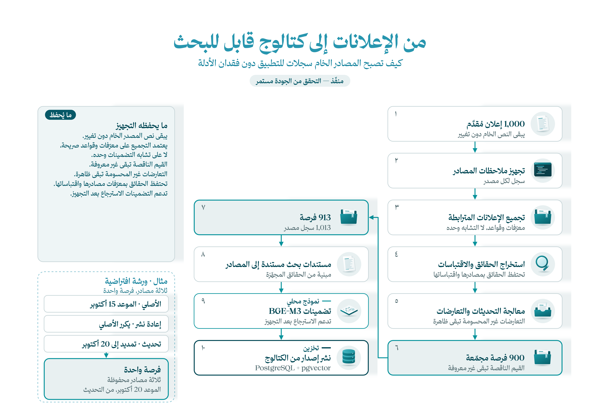

[English](README.md) | **العربية**

# البيانات — من الإعلانات إلى فهرس قابل للبحث

[الرئيسية](../README.ar.md) · [التالي: الخلفية](../backend/README.ar.md)

الإعلان مصدر، وليس بالضرورة فرصة مستقلة. يجمع تجهيزنا 1,000 إعلان في **900 فرصة**، ويضيف **13 فرصة محفوظة**؛ فيصبح المجموع 913 فرصة و1,013 سجل مصدر.

## كيف جهّزنا البيانات؟

1. أبقينا CSV الأصلي دون تعديل، وجهّزنا ملاحظات باستخدام أدوات pandas المساعدة.
2. ربطنا المصادر المتعلقة بالفرصة نفسها واستخرجنا الحقائق بكود تجهيز البيانات.
3. احتفظنا بالنصوص والاقتباسات والقيم الناقصة والتحديثات الصريحة والادعاءات المتعارضة.
4. أنشأنا مستندات البحث ومتجهاتها باستخدام BGE-M3، ونشرنا الفهرس في PostgreSQL/pgvector.

مثلًا: الموعد الأصلي ثم إعلان تمديده يخصان الفرصة نفسها. نحتفظ بالمصدرين ولا نحذف التحديث باعتباره تكرارًا. الرسوم غير المذكورة تبقى مجهولة ولا تتحول إلى صفر. يعمل هذا التنفيذ على مصادر محفوظة دون جلب مواقع خارجية.

> **توضيح الأعداد:** 900 فرصة مجمّعة + 13 فرصة إضافية محفوظة = 913 فرصة. لا يرسم المخطط مدخل الإضافات منفصلًا. التجهيز منفّذ، لكن التقييم كشف معلومات إغلاق لم يلتقطها.



## الملفات التي تتبّعها

| الملف | دوره |
|---|---|
| [raw/raw_opportunities.csv](raw/raw_opportunities.csv) | الإعلانات الأصلية وعددها 1,000 |
| [preparation_helpers.py](preparation_helpers.py) | التنظيف وملاحظات المصادر |
| [../backend/app/dataset_preparation.py](../backend/app/dataset_preparation.py) | تجميع الفرص والحقائق والأدلة |
| [prepared/real-catalog.json](prepared/real-catalog.json) | الفرص الإضافية المحفوظة |
| [prepared/catalog.json](prepared/catalog.json) | فهرس التطبيق المجهّز |
| [prepared/preparation-report.json](prepared/preparation-report.json) | أعداد السجلات وملاحظات التجهيز |
| [../backend/scripts/prepare-catalog.py](../backend/scripts/prepare-catalog.py) | التجهيز والتضمين ونشر الإصدار |

## التجهيز والنشر

بعد [إعداد الخلفية](../backend/README.ar.md#setup)، نفّذ من جذر المستودع:

```powershell
.\.venv\Scripts\python.exe backend/scripts/prepare-catalog.py --publish
```

أضف `--reuse-prepared` لنشر الحزمة المجهّزة الموجودة بدل إعادة بنائها. يدعم السكربت أيضًا السحب والرجوع إلى إصدار سابق؛ راجع `--help` قبل استخدامهما. تحفظ الإصدارات في مخطط `fursah_catalog`، وتوجد ذاكرة المتجهات المحلية في `.local/`.

تستخدم ملاحظات الدفتر 18 أكتوبر 2026، الساعة 12 ظهرًا بتوقيت الرياض. أما إتاحة الفرص في API فتُفحص عند وقت تقييم الطلب؛ ملاحظة الدفتر القديمة ليست قرار إغلاق دائمًا. يفحص [التقييم](../evals/README.ar.md) النتائج بالرجوع إلى المصادر الأصلية، وليس الحقول المستخرجة وحدها.
