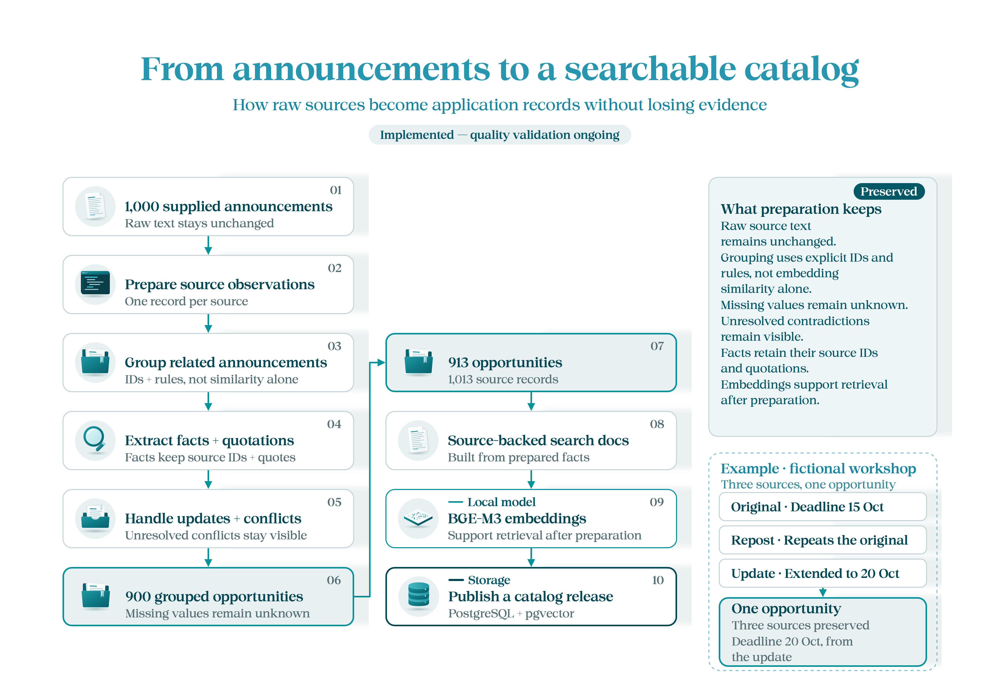

**English** | [العربية](README.ar.md)

# Data — from announcements to a searchable catalog

[Overview](../README.md) · [Next: backend](../backend/README.md)

An announcement is a source, not necessarily a separate opportunity. Our preparation groups the 1,000 supplied announcements into **900 opportunities** and adds **13 saved opportunities**, producing 913 opportunities and 1,013 source records.

## How we prepared it

1. Keep the original CSV unchanged and prepare observations using pandas helpers.
2. Link related sources and extract facts with the dataset preparation code.
3. Keep source text, quotations, missing values, explicit updates and conflicting claims.
4. Create search documents, embed them with BGE-M3 and publish the catalog to PostgreSQL/pgvector.

For example, an original deadline and a later explicit extension belong to the same opportunity. Preserve both sources; do not delete the update as a duplicate. An unstated fee remains unknown, not zero. This implementation prepares saved sources without fetching external websites.

> **Reading the counts:** 900 grouped opportunities + 13 saved additions = 913 opportunities. The diagram omits the separate additions input. Preparation is implemented, but evaluation found missed closure information.



## Files to follow

| File | Purpose |
|---|---|
| [raw/raw_opportunities.csv](raw/raw_opportunities.csv) | Original 1,000 announcements |
| [preparation_helpers.py](preparation_helpers.py) | Cleaning and source observations |
| [../backend/app/dataset_preparation.py](../backend/app/dataset_preparation.py) | Opportunity grouping, facts and evidence |
| [prepared/real-catalog.json](prepared/real-catalog.json) | Saved additional opportunities |
| [prepared/catalog.json](prepared/catalog.json) | Prepared application catalog |
| [prepared/preparation-report.json](prepared/preparation-report.json) | Preparation counts and diagnostics |
| [../backend/scripts/prepare-catalog.py](../backend/scripts/prepare-catalog.py) | Preparation, embedding and release publication |

## Prepare and publish

After [backend setup](../backend/README.md#setup), run from the repository root:

```powershell
.\.venv\Scripts\python.exe backend/scripts/prepare-catalog.py --publish
```

To publish the existing prepared package instead of rebuilding it, add `--reuse-prepared`. The script also supports withdrawal and rollback; inspect `--help` before using them. Releases use the `fursah_catalog` database schema, and local vector caches live in `.local/`.

Notebook observations use 18 October 2026 at noon Riyadh time. API availability uses the request's evaluation time, so an old notebook observation is not a permanent closure decision. [Evaluation](../evals/README.md) checks results against the original sources, not just these extracted fields.
