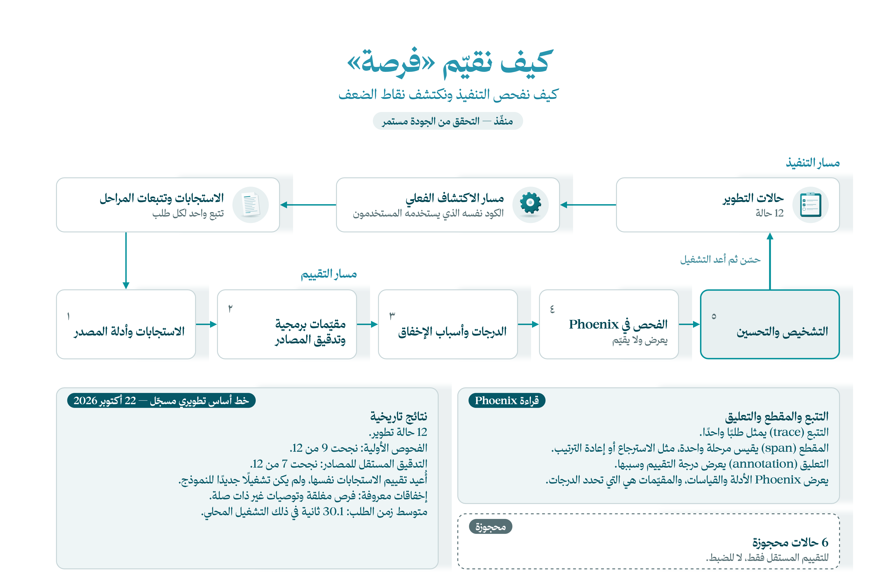

[English](README.md) | **العربية**

# التقييم — كيف فحصنا تنفيذنا؟

[الرئيسية](../README.ar.md) · [السابق: الواجهة](../frontend/README.ar.md)

نقيّم مسار البحث الحقيقي، وليس توصيات وهمية. تختبر الحالات فهم الطلب والاسترجاع والقيود وأدلة المصادر. يعرض Phoenix ما حدث، بينما تحدد فحوص الكود نجاح المعايير أو فشلها.



## شغّل ثم افحص

بعد [إعداد الخلفية](../backend/README.ar.md#setup) ونشر الفهرس، نفّذ من جذر المستودع في PowerShell:

```powershell
.\evals\run.ps1 -Demo -Open          # ثلاث حالات تطوير
.\evals\run.ps1 -Label full-dev -Open # حالات التطوير الاثنتا عشرة
```

تستخدم الأوامر Gemini الفعلي والنماذج المحلية والقاعدة. يبدأ المشغّل التطبيق داخل عمليته؛ لا يحتاج خادم API منفصلًا. لكل حالة وقت تقييم ثابت دون تعديل `.env`.

افتح [Phoenix](http://127.0.0.1:6006)، واختر **fursah-eval** ثم أثرًا باسم `eval.case`. تعرض spans التابعة أزمنة المراحل ومخرجاتها، وتعرض annotations الدرجات وأسباب الإخفاق. الـspan هو عملية مقاسة واحدة مثل الاسترجاع أو إعادة الترتيب.

## أين يوجد التقييم؟

| المكان | دوره |
|---|---|
| [cases/](cases/) | حالات التطوير والمجموعة المستقلة وبصمات الملفات |
| [run.py](run.py) | تشغيل التطبيق وتصدير الآثار والدرجات |
| [catalog_graders.py](catalog_graders.py) | فحوص المسار الكامل |
| [grading.py](grading.py) | اسم المقياس وقيمته وسببه |
| [source_audit.py](source_audit.py) | تدقيق مستقل لأدلة النص الأصلي |
| [../backend/app/instrumentation/](../backend/app/instrumentation/README.ar.md) | قياس المراحل وربط Phoenix |
| [runs/](runs/README.md) | نتائج كل تشغيل وآثاره وملخصه |
| [tests/](tests/) | اختبارات برمجية دون استدعاء النماذج |
| [archive/](archive/README.md) | التجارب والقياسات السابقة |

## ماذا وجدنا؟

نجح [خط أساس 22 أكتوبر](archive/reports/catalog-eval-baseline-v1-review.md) أولًا في 9 من 12 حالة. كشف التدقيق المستقل فرصًا مغلقة في النصوص الأصلية؛ فأصبحت النتيجة **7 من 12** بعد إعادة حساب الدرجات للردود نفسها. يوضح هذا لماذا لا يكفي فحص الحقول المستخرجة وحدها.

تشمل المشكلات الإغلاق غير المكتشف، والتوصيات غير المرتبطة، وزمن الاستجابة؛ بلغ المتوسط 30.1 ثانية في ذلك التشغيل. يتضمن العرض المختصر حالة إغلاق معروفة بالفشل. هذه نتائج محفوظة وليست تشغيلًا جديدًا لإعداد هذه الأدلة. تبقى الحالات الست المستقلة للتقييم بعد تثبيت الإصلاحات، ولا تستخدم لضبط الحل. وتحتاج التوقعات مراجعة بشرية قبل اعتبارها مرجعًا ذهبيًا.

## أوامر مفيدة

```powershell
.\evals\phoenix.ps1 -Open            # مشاهدة الآثار المحفوظة
.\evals\test.ps1                     # الاختبارات البرمجية
.\evals\run.ps1 -Demo -OfflineTraces  # حفظ الآثار دون Phoenix
```

رمز الخروج `2` يعني اكتمال التقييم مع إخفاقات جودة، أما `1` أو `3` فيشير إلى مشكلة تشغيل أو قياس. تُحفظ النتائج الجديدة في `runs/`، وحالة Phoenix في `.local/phoenix/`. التقارير التاريخية أدلة على تشغيل سابق وليست اعتمادًا للجاهزية الحالية.

توجد فحوص الواجهة والتجربة القديمة ومثال Day 4 في `archive/checks/` و`archive/starter/` و`archive/cases/`. يستخدم العرض الحالي `cases/dev.jsonl` و`catalog_graders.py`.
